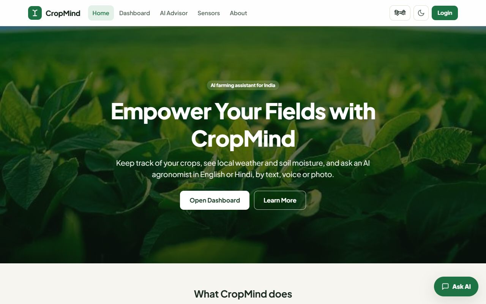
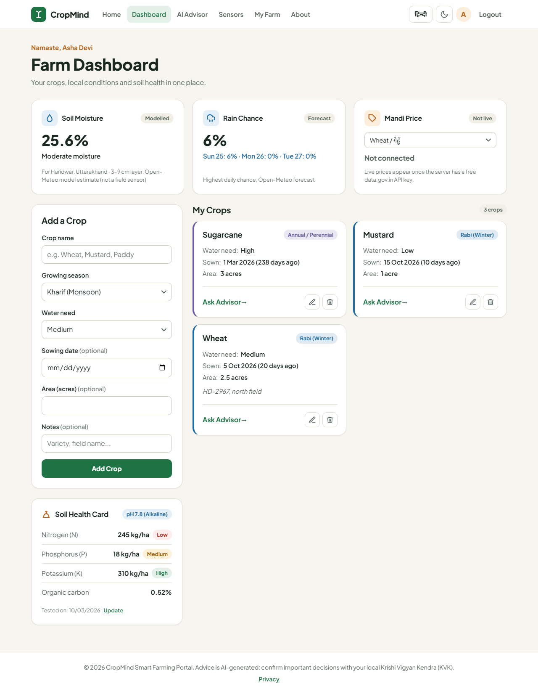
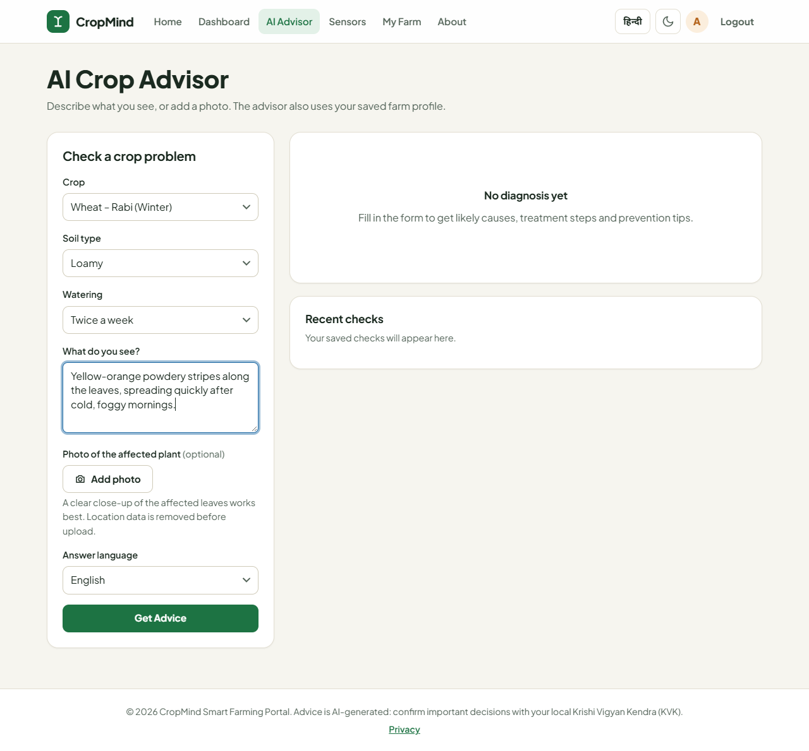
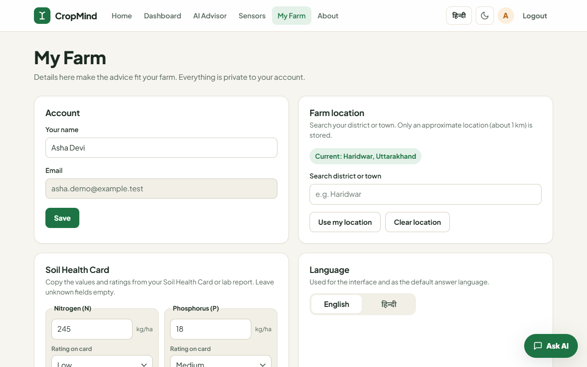
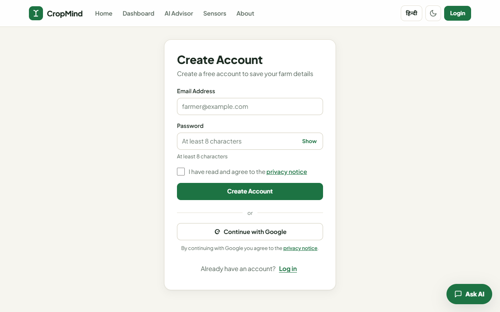
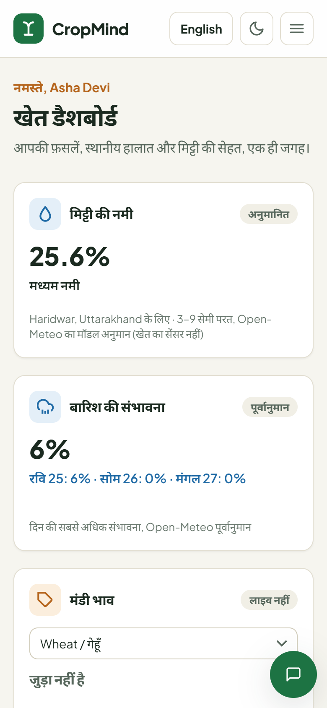

# CropMind - AI-Powered Smart Farming Assistant

CropMind is a farming assistant for Indian farmers. Each farmer keeps a private record of their crops and Soil Health Card, sees modelled soil moisture and a rain outlook for their district, and asks a Gemini-powered AI agronomist about crop problems by text, voice or leaf photo, in English or Hindi. The advice takes the farm profile (location, current weather, soil test, crop age) into account.

> AI advice can be wrong. CropMind is a decision aid; confirm important decisions with your local Krishi Vigyan Kendra (KVK).

---

## Live Demo
* **Frontend Web Application (Vercel):** [https://crop-mind-chatbot-frontend.vercel.app](https://crop-mind-chatbot-frontend.vercel.app)
* **Backend Core API (Render):** [https://cropmind-chatbot-backend.onrender.com](https://cropmind-chatbot-backend.onrender.com)

---

## Screenshots

Screenshots of a local copy with demo data.

### Home


### Farm dashboard
*Modelled soil moisture and 3-day rain outlook for the saved district (Open-Meteo), the farmer's crops with their age, and their own Soil Health Card values.*


### AI crop advisor
*Pick a crop from your list, describe the symptoms and/or add a leaf photo, and choose the answer language.*


### My Farm
*Farm location, Soil Health Card, language, sensor device keys, password, data download and account deletion.*


### Sign up


### On a phone, in Hindi


---

## Features
* **Farm profile (My Farm)**: farm location (district search or approximate GPS), Soil Health Card values with the ratings printed on the card, language, sensor device keys, password change, data download and account deletion.
* **Crop records**: add, edit and remove crops with season, water need, sowing date, area and notes. Each crop belongs to its owner, and cards show crop age.
* **Field conditions**: modelled soil moisture and a 3-day rain outlook for the saved location (Open-Meteo), and median mandi prices from Agmarknet when a data.gov.in key is configured.
* **AI crop advisor**: describe symptoms and/or upload a leaf photo. The AI also gets the farm profile (location, current weather, soil test, crop age). Past checks are saved and can be reopened or deleted.
* **AI chat assistant**: conversation saved per user (survives reloads), uses the farm profile, English or Hindi replies, voice input.
* **Sensors**: real devices post readings with their own revocable key (`X-Device-Key`). The demo stream only shows when switched on and is clearly labelled.
* **Hindi and English interface**, remembered per account; light/dark theme that follows the device setting.
* **Calm, readable design**: light-first theme with a matching dark mode (follows the device, remembered), one design system in a single stylesheet, Devanagari font for Hindi.
* **Accessible and mobile-first**: collapsible menu, 44 px touch targets, visible keyboard focus, skip link, labelled forms, reduced-motion support, installable on phones (web app manifest).
* **Reliable sign-up and login**: clear error messages instead of hidden browser tooltips, automatic login after sign-up, "show password", and automatic waiting/retrying while the free backend wakes up.
* **Privacy**: plain-language privacy notice (English and Hindi), consent at sign-up, httpOnly session cookie, no tracking.

---

## Tech Stack

### Frontend Client
* **Framework**: React 19
* **Build Tool**: Vite 7
* **Routing**: React Router DOM 6
* **Styling**: one plain-CSS design system (`frontend/src/styles.css`) with colour tokens for light and dark themes

### Backend Engine
* **Runtime**: Node.js
* **Framework**: Express 5
* **Authentication**: JSON Web Tokens (JWT) & Passport.js (Google OAuth 2.0; a sandbox consent screen is available in local development only)
* **Validation**: Zod Schemas

### Database Layer
* **Primary DB**: MongoDB Community Server / MongoDB Atlas Cloud
* **Object Modeler**: Mongoose (strict schema validation)
* **Mock Fallback**: In-memory store for local development if MongoDB is unreachable. In production (`NODE_ENV=production`) the server refuses to start without a database instead.

### AI Core
* **Model**: Google Gemini 2.5 Flash API (secured behind the backend proxy configuration)

### Deployment Platforms
* **Frontend**: Vercel
* **Backend**: Render Web Service
* **Database**: MongoDB Atlas Shared M0 Tier Cluster

---

## Setup Instructions

### Prerequisites
* **Node.js**: Version 18.0.0 or higher.
* **MongoDB**: A running local instance (`mongodb://127.0.0.1:27017/cropmind`) OR a MongoDB Atlas cloud connection string. *(Optional fallback: The app will run in in-memory Mock DB mode if no database is detected).*

### Steps to Run Locally

#### 1. Clone and Navigate to the Repository
```bash
git clone https://github.com/deepanshi-code/CropMind-Chatbot.git
cd CropMind
```

#### 2. Configure Environment Variables
Create a `.env` file in the **`backend`** directory using the provided template:
```bash
cp backend/.env.example backend/.env
```
Open `backend/.env` and define the following variables:
```ini
PORT=5000
MONGO_URI=mongodb://127.0.0.1:27017/cropmind  # (Or your cloud MongoDB Atlas URI)
GEMINI_API_KEY=your_actual_gemini_api_key      # (Optional: AI routes return mock replies if empty)
JWT_SECRET=a_long_random_string               # (Required in production)
GOOGLE_CLIENT_ID=                             # (Optional: dev-only sandbox OAuth runs if blank)
GOOGLE_CLIENT_SECRET=                         # (Optional: dev-only sandbox OAuth runs if blank)
DATA_GOV_API_KEY=                             # (Optional: free key from data.gov.in for live mandi prices)
FRONTEND_URL=http://localhost:5173            # (The public URL users open; also used for OAuth callbacks)
NODE_ENV=development                          # (Set to production on Render)
# TRUST_PROXY=4                               # (Optional: proxy hops; defaults to 4 on Render, see Deployment)
```
Generate a strong `JWT_SECRET` with:
```bash
node -e "console.log(require('crypto').randomBytes(32).toString('hex'))"
```

The frontend needs no `.env` for local development: it calls the API at the relative path `/api`,
and the Vite dev server forwards that to `http://localhost:5000`.

#### 3. Install Monorepo Dependencies
Install all packages in the workspace root:
```bash
npm install
```

#### 4. Run the Dev Servers
Start both the Frontend and Backend concurrently using the workspace script:
```bash
npm run dev
```
* **App**: open `http://localhost:5173/` (API calls are proxied to the backend)
* **Backend Server**: `http://localhost:5000/` (API docs at `/docs`)

#### 5. Run the Tests
```bash
npm test
```
* **Backend** (`npm test -w backend`, Node's built-in test runner): 52 tests covering authentication, session revocation, CSRF, per-user data isolation, validation, profile, Soil Health Card, device keys, chat and diagnosis history, data export, account deletion, the farm context given to the AI, Gemini retries, weather mapping and production safety checks.
* **Frontend** (`npm test -w frontend`, Vitest + Testing Library): 29 tests, including sign-up error handling, the wake-up/retry rules, and a check that every English string has a Hindi translation with the same placeholders.
* **CI**: `.github/workflows/ci.yml` runs both suites, the production build and `npm audit` on every push and pull request. A failing audit usually means a new advisory was published for a dependency: run `npm audit fix`, test, and push.

---

## Deployment

The browser only ever talks to the frontend's own domain. Vercel forwards `/api/*` to the Render
backend (`frontend/vercel.json`), so the login cookie is a first-party cookie and works in every
browser, including Safari, which blocks third-party cookies.

**Render (backend) environment:** `NODE_ENV=production`, `JWT_SECRET`, `MONGO_URI`,
`GEMINI_API_KEY`, `FRONTEND_URL=https://<your-vercel-domain>`, optionally `GOOGLE_CLIENT_ID`,
`GOOGLE_CLIENT_SECRET`, `DATA_GOV_API_KEY`. In production the server refuses to start without
`JWT_SECRET` or a reachable MongoDB.

**Google Cloud Console:** the OAuth redirect URI is `https://<your-vercel-domain>/api/auth/google/callback`.

**`TRUST_PROXY`:** rate limits are keyed on the client IP. On Render the default is 4 hops
(browser → Vercel → Cloudflare → Render proxy, measured on this deployment). Check it at
`https://<your-vercel-domain>/api/health`: `clientIp` must equal your real public IP. If the
hosting setup changes, set `TRUST_PROXY` to the new hop count.

**Deploy check:** `/api/health` also shows `commit`, the first 7 characters of the commit Render is running.

**Database check:** the same `/api/health` response shows `"database": "mongodb"` when Render is
connected to Atlas. `"in-memory"` means `MONGO_URI` is missing or wrong and all data is lost on restart.

**Free-plan sleep (important):** the free Render service sleeps after 15 minutes without traffic.
While it sleeps, Render refuses requests that arrive through Vercel's shared proxy IPs with
`429 Too Many Requests` and the header `X-Render-Routing: hibernate-rate-limited`, and does not
wake up from them. CropMind handles this in three ways:
1. The browser pings `https://<render-service>/health` directly (the visitor's own IP) on page
   load, which wakes the service (`frontend/src/services/wake.js`; allowed in the CSP in `vercel.json`).
2. The API client retries those refusals for about 70 seconds while showing a "server is waking
   up" notice. Sign-up is retried safely (it checks whether the account was already created).
3. `.github/workflows/keep-awake.yml` pings the backend every 10 minutes so it rarely sleeps
   (about 744 of Render's 750 free instance hours per month). GitHub pauses scheduled workflows
   after 60 days without commits; re-enable it in the Actions tab if needed.

A paid Render instance does not sleep and avoids all of this.

---

## API Documentation

The backend server runs on `http://localhost:5000` by default and exposes these key REST API endpoints. You can view the live interactive developer portal at `http://localhost:5000/docs`.

**Sessions:** login sets an `httpOnly` cookie (`cropmind_session`, 7 days). Scripts and devices
may instead send `Authorization: Bearer <token>`. Every `POST`/`PUT`/`DELETE` from a browser
must include the header `X-Requested-With: CropMind` (CSRF protection).

### 1. Authentication
* **`POST /api/auth/register`**: Registers a new farmer user (password at least 8 characters).
  * *Request Body*: `{"email": "farmer@cropmind.com", "password": "password123"}`
* **`POST /api/auth/login`**: Verifies credentials and sets the session cookie. Rate limited per network and per account.
  * *Response*: `{"user": {"id": "...", "email": "farmer@cropmind.com"}}`
* **`GET /api/auth/me`**: Returns the logged-in user.
* **`POST /api/auth/logout`**: Revokes all of the user's sessions and clears the cookie.
* **`GET /api/auth/google`**: Starts Google OAuth 2.0. On success the session cookie is set and the user lands on `/dashboard`; no token ever appears in a URL. Without Google keys, a password-less sandbox is offered only in development with the in-memory database.

### 2. Crop Registry (Requires Session)
* **`GET /api/crops`**: Retrieves the logged-in user's crops.
* **`GET /api/crops/search/:name`**: Case-insensitive name search within the user's crops.
* **`POST /api/crops`**: Registers a new crop.
  * *Request Body*: `{"name": "Barley", "season": "Rabi", "water": "Low"}`
* **`PUT /api/crops/:id`**: Modifies an existing crop (any subset of fields).
* **`DELETE /api/crops/:id`**: Removes a crop record from the catalog.

### 3. Telemetry Logs (Requires Session)
* **`GET /api/telemetry`**: Retrieves the user's 30 most recent sensor logs.
* **`POST /api/telemetry`**: Registers a new log from an IoT telemetry sensor.
  * *Request Body*: `{"time": "12:00:00", "type": "warning", "text": "Low moisture."}`

### 4. AI Agronomist (Requires Session, rate limited per user)
* **`POST /api/ai/chat`**: asks Gemini a question (max 1000 chars). The server adds the last 10 saved messages and the farm profile as context, and saves both turns. 30 requests / 15 min.
  * *Request Body*: `{"message": "How many irrigations does my wheat need?", "language": "hi"}`
* **`POST /api/ai/diagnose`**: Returns a structured diagnosis (validated JSON) from a symptom description, a photo, or both. 10 requests / 15 min. The `confidence` field is the model's own rough estimate, not a measured accuracy.
  * *Request Body*: `{"cropName": "Tomato", "symptoms": "Yellow leaves", "soilType": "Loamy", "wateringFrequency": "Daily", "language": "en", "image": {"mimeType": "image/jpeg", "data": "<base64, max 4 MB>"}}`

### 5. Field Insights (Requires Session)
* **`GET /api/insights/weather?lat=..&lon=..`**: modelled soil moisture (3–9 cm), temperature, humidity and 3-day rain probability from Open-Meteo. Coordinates are rounded to about 1 km.
* **`GET /api/insights/places?q=Haridwar&lang=en`**: Indian district/town search (Open-Meteo geocoding, English or Hindi names).
* **`GET /api/insights/mandi?commodity=Wheat&state=Uttarakhand`**: median modal price across reporting markets from Agmarknet (data.gov.in). Needs `DATA_GOV_API_KEY`; returns `503` with `configured: false` otherwise.

### 6. Profile & Account (Requires Session)
* **`GET /api/profile`** / **`PUT /api/profile`**: name, language (`en`/`hi`), location `{name, lat, lon}` (null clears it).
* **`PUT /api/profile/soil-test`** / **`DELETE /api/profile/soil-test`**: Soil Health Card values (N, P, K in kg/ha, pH, organic carbon, test date) and the ratings printed on the card.
* **`POST /api/profile/password`**: change password (or set one for Google accounts). Signs out other devices.
* **`GET /api/profile/export`**: all stored data as JSON.
* **`DELETE /api/profile`**: delete the account and everything it owns. Body `{confirmation}` is the password (or the email for Google accounts).

### 7. Sensor Devices (Requires Session)
* **`GET /api/devices`**, **`POST /api/devices`** `{name}` returns the key once, **`DELETE /api/devices/:id`** revokes it.
* Devices send `POST /api/telemetry` with header `X-Device-Key: cmd_...`. A device key can only post readings.

### 8. History (Requires Session)
* **`GET /api/ai/chat/history`**, **`DELETE /api/ai/chat/history`**
* **`GET /api/ai/diagnoses`**, **`DELETE /api/ai/diagnoses/:id`**

---

## Evaluating the AI

`backend/eval/` contains an evaluation harness for the diagnosis feature: accuracy with a 95%
confidence interval, a majority-class baseline, accuracy by self-reported confidence, per-crop
results and a CSV for manual review. It needs a labelled case file built from citable sources
(ICAR / state agricultural university / KVK material). See [backend/eval/README.md](backend/eval/README.md).

---

## Architecture & Folder Structure

CropMind follows a modular monorepo architecture separating the visual client (Frontend) and the server controllers (Backend).

```
CropMind/
├── backend/                  # Node.js Server & Database Configuration
│   ├── middleware/           # Session auth & CSRF, Zod validation, rate limiting
│   ├── models/               # MongoDB Mongoose Schemas (User, Crop, TelemetryLog)
│   ├── routes/               # API routers (auth, ai, crops, telemetry, insights, profile, devices)
│   ├── services/             # Gemini client, diagnosis, farm context for the AI, sessions, weather, users
│   ├── eval/                 # Offline AI evaluation harness
│   ├── tests/                # Automated API and unit tests
│   ├── public/               # Static API docs page (/docs)
│   ├── config.js             # Environment configuration & production checks
│   ├── db.js                 # Database connector & dev-only in-memory fallback
│   ├── app.js                # Express app: middleware, routes, error handling
│   ├── server.js             # Connects the database and starts listening
│   └── package.json
│
├── frontend/                 # Vite + React Client
│   ├── public/               # Favicon & assets
│   ├── src/
│   │   ├── assets/           # Dashboard hero visuals
│   │   ├── components/       # UI elements (FieldConditions, SoilCard, CropCard, Chat, SensorLogs)
│   │   ├── context/          # Auth context (logged-in user from /api/auth/me)
│   │   ├── i18n/             # English/Hindi strings and language context
│   │   ├── pages/            # Home, Dashboard, Advisor, Sensors, My Farm, About, Privacy, Login
│   │   ├── test/             # Vitest + Testing Library tests
│   │   ├── services/         # Axios API client
│   │   ├── App.jsx           # Routing & dark-theme triggers
│   │   └── styles.css        # Core custom layout responsive styles
│   ├── vite.config.js        # Dev server with /api proxy
│   ├── vercel.json           # /api proxy to Render + security headers
│   └── package.json
│
├── screenshots/              # Embedded documentation images
└── package.json              # Monorepo Workspace configuration
```

---

## Known Limitations

* **Free hosting**: the free Render backend can sleep (see "Free-plan sleep" under Deployment); the first request after a quiet period can take up to a minute. The app waits and shows a notice meanwhile.
* **MongoDB M0 free tier**: 512 MB storage, and the cluster pauses after long inactivity (resume it in Atlas).
* **Field data is modelled, not measured**: soil moisture and rain come from Open-Meteo's model for the saved area. Real field readings need your own sensor devices.
* **AI accuracy not yet measured**: the evaluation harness exists but needs a labelled case set from published sources. Advice should be confirmed with a KVK or agriculture officer.
* **No password reset by email / email verification**: these need an email-sending service (e.g. SMTP or Resend), which is not configured. Users can change their password while logged in.
* **Hindi translation** was written for this project and should be reviewed by a native speaker who works with farmers.
* **Voice input** uses the browser's speech recognition (Chrome, Edge, Android), not Firefox.
* **Sandbox OAuth**: without Google keys, a password-less sandbox sign-in exists only in local development with the in-memory database.
* **No error monitoring service** (e.g. Sentry) is connected; check Render logs and `/api/health`.

---

## Credits & Acknowledgements
* **Mentorship & Evaluation**: Developed for the TBI-GEU Internship Capstone.
* **AI Engine**: Powered by Google DeepMind's Gemini API developer sandbox models.
* **Tech Guidelines**: Implemented in accordance with the Advanced Agentic Coding practices.
* **AI assistance**: parts of the security hardening, redesign, tests and documentation were developed with Claude Code (Anthropic). Those commits are marked `Co-Authored-By: Claude` in the git history.
