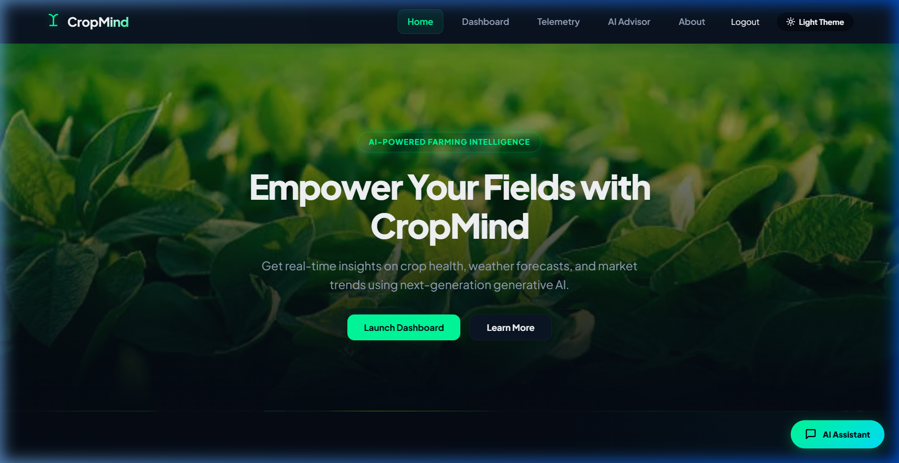

# CropMind - AI-Powered Smart Farming Assistant

CropMind is an advanced smart agricultural intelligence platform designed to empower modern farming decisions. It combines a per-user crop catalog with a Gemini-powered agronomy advisor (text or photo, English or Hindi), a chat assistant, modelled local weather and soil-moisture data, and mandi prices. Connecting real in-field IoT sensors is planned work; the sensor log stream is currently simulated.

---

## Live Demo
* **Frontend Web Application (Vercel):** [https://crop-mind-chatbot-frontend.vercel.app](https://crop-mind-chatbot-frontend.vercel.app)
* **Backend Core API (Render):** [https://cropmind-chatbot-backend.onrender.com](https://cropmind-chatbot-backend.onrender.com)

---

## Screenshots

### 1. Home / Landing Screen
*A premium dark-themed cybernetic HUD dashboard greeting farmers with interactive guides.*


### 2. Secure Portal Authentication
*Registration and login page with Google OAuth (plus a sandbox simulator available only in local development).*


### 3. Smart Farming Dashboard HUD
*Shows the user's crop catalog, local soil moisture and rain forecast, mandi prices and a simulated sensor log stream.*


### 4. AI Agronomist Diagnostic Advisor
*Interactive crop symptom analysis generating organic treatment checklists, preventative measures, and customized NPK guidance.*


---

## Features
* **Crop Catalog Registry**: CRUD capabilities to add, update, and remove crops. Each crop belongs to the user who created it. Crop data is persisted directly in MongoDB (or a safe in-memory database fallback during local testing).
* **Field Conditions**: Soil moisture and 3-day rain probability for the user's location (Open-Meteo weather model), and median mandi prices from Agmarknet when a data.gov.in key is configured.
* **AI Agronomist Diagnostics**: Diagnostic form that takes crop, soil type, watering schedule, symptom description and/or a photo of the affected plant, with advice in English or Hindi.
* **Interactive Treatment Checklists**: Generates checkable organic and chemical intervention tasks that update client states dynamically.
* **Floating AI Chat Assistant**: Floating bubble widget present on all pages for logged-in users, with conversation memory, English/Hindi replies and voice input.
* **Dual Color Themes**: Built-in support for high-contrast light and dark themes using modern CSS variables.

---

## Tech Stack

### Frontend Client
* **Framework**: React 19
* **Build Tool**: Vite 7
* **Routing**: React Router DOM 6
* **Styling**: Vanilla CSS (TailwindCSS omitted for customizable grid layout and custom responsive theme animations)

### Backend Engine
* **Runtime**: Node.js
* **Framework**: Express 5
* **Authentication**: JSON Web Tokens (JWT) & Passport.js (Google OAuth 2.0; a sandbox consent screen is available in local development only)
* **Validation**: Zod Schemas

### Database Layer
* **Primary DB**: MongoDB Community Server / MongoDB Atlas Cloud
* **Object Modeler**: Mongoose (strict schema validation)
* **Mock Fallback**: In-memory store for local development if MongoDB is unreachable. In production (`NODE_ENV=production`) the server refuses to start without a database instead.

### AI Core
* **Model**: Google Gemini 2.5 Flash API (secured behind the backend proxy configuration)

### Deployment Platforms
* **Frontend**: Vercel
* **Backend**: Render Web Service
* **Database**: MongoDB Atlas Shared M0 Tier Cluster

---

## Setup Instructions

### Prerequisites
* **Node.js**: Version 18.0.0 or higher.
* **MongoDB**: A running local instance (`mongodb://127.0.0.1:27017/cropmind`) OR a MongoDB Atlas cloud connection string. *(Optional fallback: The app will run in in-memory Mock DB mode if no database is detected).*

### Steps to Run Locally

#### 1. Clone and Navigate to the Repository
```bash
git clone https://github.com/deepanshi-code/CropMind-Chatbot.git
cd CropMind
```

#### 2. Configure Environment Variables
Create a `.env` file in the **`backend`** directory using the provided template:
```bash
cp backend/.env.example backend/.env
```
Open `backend/.env` and define the following variables:
```ini
PORT=5000
MONGO_URI=mongodb://127.0.0.1:27017/cropmind  # (Or your cloud MongoDB Atlas URI)
GEMINI_API_KEY=your_actual_gemini_api_key      # (Optional: AI routes return mock replies if empty)
JWT_SECRET=a_long_random_string               # (Required in production)
GOOGLE_CLIENT_ID=                             # (Optional: dev-only sandbox OAuth runs if blank)
GOOGLE_CLIENT_SECRET=                         # (Optional: dev-only sandbox OAuth runs if blank)
DATA_GOV_API_KEY=                             # (Optional: free key from data.gov.in for live mandi prices)
FRONTEND_URL=http://localhost:5173            # (The public URL users open; also used for OAuth callbacks)
NODE_ENV=development                          # (Set to production on Render)
TRUST_PROXY=1                                 # (Number of proxies in front of the backend, see Deployment)
```
Generate a strong `JWT_SECRET` with:
```bash
node -e "console.log(require('crypto').randomBytes(32).toString('hex'))"
```

The frontend needs no `.env` for local development: it calls the API at the relative path `/api`,
and the Vite dev server forwards that to `http://localhost:5000`.

#### 3. Install Monorepo Dependencies
Install all packages in the workspace root:
```bash
npm install
```

#### 4. Run the Dev Servers
Start both the Frontend and Backend concurrently using the workspace script:
```bash
npm run dev
```
* **App**: open `http://localhost:5173/` (API calls are proxied to the backend)
* **Backend Server**: `http://localhost:5000/` (API docs at `/docs`)

#### 5. Run the Tests
```bash
npm test -w backend
```
30 automated tests (Node's built-in test runner, no extra dependencies) cover authentication,
session revocation, CSRF protection, per-user data isolation, input validation, AI route guards,
the weather integration, the evaluation scoring helpers and the production safety checks.

---

## Deployment

The browser only ever talks to the frontend's own domain. Vercel forwards `/api/*` to the Render
backend (`frontend/vercel.json`), so the login cookie is a first-party cookie and works in every
browser, including Safari, which blocks third-party cookies.

**Render (backend) environment:** `NODE_ENV=production`, `JWT_SECRET`, `MONGO_URI`,
`GEMINI_API_KEY`, `FRONTEND_URL=https://<your-vercel-domain>`, optionally `GOOGLE_CLIENT_ID`,
`GOOGLE_CLIENT_SECRET`, `DATA_GOV_API_KEY`. In production the server refuses to start without
`JWT_SECRET` or a reachable MongoDB.

**Google Cloud Console:** the OAuth redirect URI is `https://<your-vercel-domain>/api/auth/google/callback`.

**`TRUST_PROXY`:** rate limits are keyed on the client IP. Open `https://<your-vercel-domain>/api/health`
and compare `clientIp` with your real public IP (e.g. from whatismyip.com). If it shows a
Vercel/Render address instead, increase `TRUST_PROXY` by one and check again.

**Database check:** the same `/api/health` response shows `"database": "mongodb"` when Render is
connected to Atlas. `"in-memory"` means `MONGO_URI` is missing or wrong and all data is lost on restart.

---

## API Documentation

The backend server runs on `http://localhost:5000` by default and exposes these key REST API endpoints. You can view the live interactive developer portal at `http://localhost:5000/docs`.

**Sessions:** login sets an `httpOnly` cookie (`cropmind_session`, 7 days). Scripts and devices
may instead send `Authorization: Bearer <token>`. Every `POST`/`PUT`/`DELETE` from a browser
must include the header `X-Requested-With: CropMind` (CSRF protection).

### 1. Authentication
* **`POST /api/auth/register`**: Registers a new farmer user (password at least 8 characters).
  * *Request Body*: `{"email": "farmer@cropmind.com", "password": "password123"}`
* **`POST /api/auth/login`**: Verifies credentials and sets the session cookie. Rate limited per network and per account.
  * *Response*: `{"user": {"id": "...", "email": "farmer@cropmind.com"}}`
* **`GET /api/auth/me`**: Returns the logged-in user.
* **`POST /api/auth/logout`**: Revokes all of the user's sessions and clears the cookie.
* **`GET /api/auth/google`**: Starts Google OAuth 2.0. On success the session cookie is set and the user lands on `/dashboard`; no token ever appears in a URL. Without Google keys, a password-less sandbox is offered only in development with the in-memory database.

### 2. Crop Registry (Requires Session)
* **`GET /api/crops`**: Retrieves the logged-in user's crops.
* **`GET /api/crops/search/:name`**: Case-insensitive name search within the user's crops.
* **`POST /api/crops`**: Registers a new crop.
  * *Request Body*: `{"name": "Barley", "season": "Rabi", "water": "Low"}`
* **`PUT /api/crops/:id`**: Modifies an existing crop (any subset of fields).
* **`DELETE /api/crops/:id`**: Removes a crop record from the catalog.

### 3. Telemetry Logs (Requires Session)
* **`GET /api/telemetry`**: Retrieves the user's 30 most recent sensor logs.
* **`POST /api/telemetry`**: Registers a new log from an IoT telemetry sensor.
  * *Request Body*: `{"time": "12:00:00", "type": "warning", "text": "Low moisture."}`

### 4. AI Agronomist (Requires Session, rate limited per user)
* **`POST /api/ai/chat`**: Asks Gemini a question (max 1000 chars), with up to 10 earlier messages for context. 30 requests / 15 min.
  * *Request Body*: `{"message": "And for wheat?", "history": [{"role": "user", "text": "When to sow rice?"}, {"role": "assistant", "text": "..."}], "language": "hi"}`
* **`POST /api/ai/diagnose`**: Returns a structured diagnosis (validated JSON) from a symptom description, a photo, or both. 10 requests / 15 min. The `confidence` field is the model's own rough estimate, not a measured accuracy.
  * *Request Body*: `{"cropName": "Tomato", "symptoms": "Yellow leaves", "soilType": "Loamy", "wateringFrequency": "Daily", "language": "en", "image": {"mimeType": "image/jpeg", "data": "<base64, max 4 MB>"}}`

### 5. Field Insights (Requires Session)
* **`GET /api/insights/weather?lat=..&lon=..`**: Modelled soil moisture (3–9 cm), temperature, humidity and 3-day rain probability from Open-Meteo. Coordinates are rounded to about 1 km.
* **`GET /api/insights/mandi?commodity=Wheat&state=Uttarakhand`**: Median modal price across reporting markets from Agmarknet (data.gov.in). Needs `DATA_GOV_API_KEY`; returns `503` with `configured: false` otherwise.

---

## Evaluating the AI

`backend/eval/` contains an evaluation harness for the diagnosis feature: accuracy with a 95%
confidence interval, a majority-class baseline, accuracy by self-reported confidence, per-crop
results and a CSV for manual review. It needs a labelled case file built from citable sources
(ICAR / state agricultural university / KVK material). See [backend/eval/README.md](backend/eval/README.md).

---

## Architecture & Folder Structure

CropMind follows a modular monorepo architecture separating the visual client (Frontend) and the server controllers (Backend).

```
CropMind/
├── backend/                  # Node.js Server & Database Configuration
│   ├── middleware/           # Session auth & CSRF, Zod validation, rate limiting
│   ├── models/               # MongoDB Mongoose Schemas (User, Crop, TelemetryLog)
│   ├── routes/               # API routers (auth, ai, crops, telemetry, insights)
│   ├── services/             # Gemini client, diagnosis logic, session handling
│   ├── eval/                 # Offline AI evaluation harness
│   ├── tests/                # Automated API and unit tests
│   ├── public/               # Static API docs page (/docs)
│   ├── config.js             # Environment configuration & production checks
│   ├── db.js                 # Database connector & dev-only in-memory fallback
│   ├── app.js                # Express app: middleware, routes, error handling
│   ├── server.js             # Connects the database and starts listening
│   └── package.json
│
├── frontend/                 # Vite + React Client
│   ├── public/               # Favicon & assets
│   ├── src/
│   │   ├── assets/           # Dashboard hero visuals
│   │   ├── components/       # UI elements (FieldConditions, NPKGauge, Chat, SensorLogs)
│   │   ├── context/          # Auth context (logged-in user from /api/auth/me)
│   │   ├── pages/            # View pages (Home, Dashboard, Telemetry, Advisor, About, Login)
│   │   ├── services/         # Axios API client
│   │   ├── App.jsx           # Routing & dark-theme triggers
│   │   └── styles.css        # Core custom layout responsive styles
│   ├── vite.config.js        # Dev server with /api proxy
│   ├── vercel.json           # /api proxy to Render + security headers
│   └── package.json
│
├── screenshots/              # Embedded documentation images
└── package.json              # Monorepo Workspace configuration
```

---

## Known Limitations

* **Render Server Spin-Down (Cold Start)**: The backend is deployed on a free Render tier. As a result, the server spins down after **15 minutes of inactivity**. The first API call sent to the app after a period of dormancy will trigger a cold-start, requiring **30 to 60 seconds** to boot.
* **MongoDB M0 Storage Ceiling**: The database uses MongoDB Atlas's free M0 cluster, which has a memory capacity limit of **512 MB**, suitable only for developer testing and demonstration.
* **Field data is modelled, not measured**: Soil moisture and rain come from Open-Meteo's weather model for the user's approximate location, not from sensors in the field. The sensor log stream on the dashboard is still simulated.
* **AI accuracy not yet measured**: The evaluation harness exists, but no labelled case set has been run yet. Treat diagnoses as suggestions and consult a local agriculture expert (KVK) for decisions.
* **Interface language**: AI answers can be in Hindi, but the interface text is still English only.
* **Voice input** uses the browser's speech recognition, available in Chrome, Edge and Android browsers but not Firefox.
* **Sandbox OAuth**: Without Google keys, a password-less sandbox sign-in is available only in local development with the in-memory database.

---

## Credits & Acknowledgements
* **Mentorship & Evaluation**: Developed for the TBI-GEU Internship Capstone.
* **AI Engine**: Powered by Google DeepMind's Gemini API developer sandbox models.
* **Tech Guidelines**: Implemented in accordance with the Advanced Agentic Coding practices.
